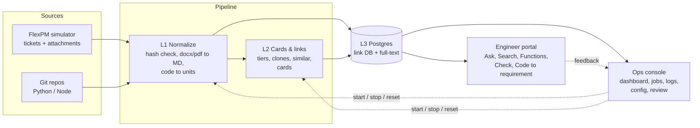

# Shopfloor KB Hub

A knowledge base that connects every FlexPM change request (CR) to the code that implemented it, across every shopfloor site. Engineers can find a function, see **why** it was built, see **where else** it runs, and catch **duplicates** before building the same thing again.

This repository holds the proposal and a working **prototype** that runs the whole process end to end on simulated data, so the idea can be shown to management before the real project is approved.

| | |
|---|---|
| **Engineer portal** | https://yianxingjian-ozkb.hf.space |
| **Operations console** | https://yianxingjian-ozkb.hf.space/ops/ |
| **Proposal** | [`docs/project-profile.md`](docs/project-profile.md) |
| **Interactive walkthrough** | [`docs/poc-walkthrough.html`](docs/poc-walkthrough.html) |

> All tickets, sites, customers and code in the prototype are fictional and generated by a built-in simulator.

---

## Contents

- [The problem](#the-problem)
- [Features](#features)
  - [Engineer portal](#engineer-portal)
  - [Operations console](#operations-console)
  - [Knowledge pipeline](#knowledge-pipeline)
- [Architecture](#architecture)
- [Prototype vs. production](#prototype-vs-production)
- [Run it locally](#run-it-locally)
- [Configuration](#configuration)
- [Cloud deployment](#cloud-deployment)
- [API](#api)
- [Demo script](#demo-script)
- [Repository layout](#repository-layout)
- [Limitations](#limitations)

---

## The problem

The company's MES platform runs on thousands of on-premises instances across Asia and the Americas, built up over 20+ years. The knowledge behind it is split:

- **FlexPM** holds the *why*: CR tickets, revisions such as `121648-02`, specs, slides and customer documents.
- **Azure DevOps** holds the *how*: repositories, pull requests and commits.

Only newer repos (named `<Region>-<Customer>-FLEXPM<id>-<Feature>`) link cleanly to a CR. Older code is linked partly or not at all, and code is often copied to another site with no CR ("plug-and-play"). When the original developer leaves, nobody can say why the code exists, and the same function gets built again elsewhere.

## Features

### Engineer portal

The portal is the end-user front end at `/`.

| Feature | What it does |
|---|---|
| **Ask** | Answers questions in plain language with numbered citations to tickets, documents and code. A panel shows how the answer was found, step by step (`classify → search_kb → which_sites → get_card → …`). |
| ↳ *Which sites…?* | Lists every site with a function, read from the link database rather than top-N search, so the list is complete within known links. Includes plug-and-play copies without a CR and similar functions built separately, plus a note on how many commits are still unlinked. |
| ↳ *Why…?* | Explains the original requirement and reason, the business rules with their limits, and how the function evolved over revisions. |
| ↳ *Ticket questions* | A ticket or CR number anywhere in the question (`128605-01`, `CR 128605`, `FLEXPM128605-01`) pins the answer to that ticket: what it does, the rules, the code as it was, revisions and other sites. |
| ↳ *Where is the code…?* | Lists the functions involved, with copies collapsed into one line each. |
| ↳ Grounded by default | Answers are assembled from the data, with no model, so they cannot invent facts. Off-topic questions get "nothing found". An optional open-weight model on Hugging Face can rewrite answers while keeping the citations. |
| **Search** | Full-text search over knowledge cards, attachments and code. Ticket and CR numbers jump straight to the page. Code copies are collapsed into one result per clone group. |
| **Functions** | One page per shopfloor function: every site that has it, each revision and what it added, plug-and-play copies with no CR, and look-alikes built separately elsewhere. |
| **Check before you build** | Paste the requirement of a new CR. The result is "probably exists already", "something similar exists" or "no similar function", with the matching tickets, sites and link confidence. Meant for the dev-lead approval step, before anyone starts building. |
| **Code → requirement** | Pick a file and click any line to see the commit that last changed it, the CR behind it, why it was built, and where the same code lives elsewhere, even when the author has left. This stands in for the planned IDE plug-in. |
| **Ticket pages** | The knowledge card with source tags, the original FlexPM text and attachments, linked code with evidence, edit history, revisions and similar tickets at other sites. |
| ↳ *Ticket package* | One zip with the knowledge card, the FlexPM ticket export with history, the original attachments, the linked code exactly as it was at each commit, and a references file. |
| ↳ *Feedback* | "Wrong link", "Outdated card" and 👍/👎 on answers go to the review queue for a domain expert. |

### Operations console

The operations console is at `/ops/`, for whoever runs the system.

| Feature | What it does |
|---|---|
| **Dashboard** | Counts, the pipeline flow (FlexPM → L1 → L2 → index → review) with waiting and running jobs per stage, a throughput chart, cards by link confidence, recent runs and errors. Refreshes every 2 seconds. |
| **Control & configuration** | Start, stop or single-step each scheduler. Every setting has help text, and every change is saved with who and when. **Reset demo** rewinds everything. **Reset and load full demo** plays all 100 tickets at full speed. |
| **Job monitor** | Each detected change becomes a job that moves from *before* (pending) to *processing* to *done* or *failed*. Click a job to see its input, output, error and log lines. Failed jobs can be retried. |
| **Logs** | Structured logs from the simulator, L1, L2, indexing and admin actions. Filter by level, source, ticket or text, with a live tail and a full trace per ticket. |
| **Run history** | One row per scheduler run: trigger, duration, items picked, done and failed. |
| **Review queue** | What the machine is unsure about: inferred CR↔code links, plug-and-play copies, possible duplicates, commits with no CR, and engineer feedback. Approving an inferred link makes it *strong · confirmed by expert*, and L2 regenerates the card. |
| **Knowledge views** | Tickets, sites, CR families, repositories and code units, with clone-group membership. |

### Knowledge pipeline

| Stage | What it does |
|---|---|
| **FlexPM simulator** | A scripted, seeded timeline of 100 task revisions (new CRs, revision +1, ticket edits), with `.docx`, `.pdf` and `.md` attachments and small Python/Node repositories committed to git. It deliberately includes plug-and-play copies, functions rebuilt independently at another site, legacy repos without CR names, and tickets with no code. The same seed always tells the same story, so the demo is repeatable. |
| **L1 · Normalize** (scheduler) | Scans the raw store and detects changes by SHA-256, then queues one job per change. Converts docx/pdf/md to Markdown, keeps every ticket edit as a version, and splits code into function-level units with fingerprints. |
| **L2 · Cards & links** (scheduler) | Links commits to CRs with a confidence tier and evidence (see below), and groups code copies into clone groups. Finds similar tickets and flags cross-site duplicates. Writes **one knowledge card per task revision**, using the code **as it was** at the linked commit (`git show <sha>:<file>`), not today's version. |
| **L3 · Index** | Postgres holds the link database, cards, documents and code, with full-text search. |

**Link confidence tiers**

| Tier | Evidence | Shown as |
|---|---|---|
| Confirmed | Repo name contains `FLEXPM<cr>`, and the commit names the revision (or the revision is chosen by date) | Fact |
| Strong | CR number in the commit message, or an expert approved an inferred link | Strong |
| Inferred | Code is a copy of code that belongs to a CR (code similarity), or the commit text matches a ticket | Inferred, sent for review |
| Unlinked | No evidence | Knowledge gap, sent for review |

**Knowledge card**: front-matter (ticket, family, site, repos, commits, link confidence, template version, model), then Overview, Business logic, Technical logic, Variants & reuse, Change history, Gaps & confidence and References. Every statement carries a source tag: `[T1]` ticket, `[A1]` attachment, `[C1]` code with repo, path, line range and commit.

## Architecture



One Node.js process serves the API and both web front ends, and runs the three schedulers. Postgres is Neon in the cloud and embedded PGlite on a laptop; the code is the same. The raw store is a folder: FlexPM exports sit next to a git repository whose sub-folders are the source repos.

## Prototype vs. production

| Area | Production design (proposal) | Prototype |
|---|---|---|
| FlexPM | Existing downloader app, ~20,000 tickets | Seeded simulator, 100 tickets |
| Source code | Git mirror of all Azure DevOps repos | One git repo with sub-folders per repo |
| Search | Elasticsearch/OpenSearch hybrid (keyword + vector), Zoekt for code | Postgres full-text search |
| Clone detection | AST hashing + MinHash/LSH | Token MinHash with exact-hash check |
| Cards | Open-weight LLM via vLLM + LiteLLM | Built-in rule-based writer; optional Hugging Face model |
| Ask | Agent with tools, LLM-written answers | Same tools, grounded answers; optional model rewrite |
| IDE | Homegrown IDE + MCP server | "Code → requirement" page |
| Identity | Company SSO (Entra ID) | Placeholder; optional admin password |
| Platform | Kubernetes on rented EC2, later company servers | One Docker container on a Hugging Face Space + Neon |

## Run it locally

Requires Node.js 20+ and git.

```bash
cd prototype
npm install
npm start                 # http://localhost:7860  (portal)  ·  /ops/  (console)
```

With no `DATABASE_URL`, an embedded Postgres (PGlite) is created in `prototype/.data/`.

To load data:
- **From the UI:** Ops console → **Control & configuration** → **Reset and load full demo** (about 30 seconds locally).
- **Live:** **Dashboard → Start all schedulers** to watch tickets arrive one by one.
- **Headless:** `npm run demo` resets and plays all 383 events (100 tickets) in about 30 seconds, then prints a summary.

**Environment variables** (all optional):

| Variable | Purpose |
|---|---|
| `DATABASE_URL` | Postgres connection string (for example Neon). Without it, PGlite is used. |
| `PORT` | HTTP port, default `7860`. |
| `ADMIN_PASSWORD` | Required for start/stop, reset, config changes and review decisions. Unset = open. |
| `HF_TOKEN` | Hugging Face token. Used for cards and Ask when `llm.provider` is `hf` (needs Inference Provider credits). |
| `SIM_DIR`, `DATA_DIR` | Locations of the raw store and the PGlite data. |
| `PG_POOL_MAX` | Postgres connection pool size, default `10`. |
| `AUTOSTART=1` | Start all schedulers when the server starts. |

## Configuration

All settings are edited in the Ops console and stored in the database, with a change history.

| Setting | Default | Meaning |
|---|---|---|
| `sim.seed` | 42 | Simulator seed; the same seed gives the same demo story (applied on reset) |
| `sim.interval_sec` / `sim.events_per_tick` | 4 / 2 | How fast FlexPM events arrive |
| `l1.interval_sec` / `l1.batch_size` | 3 / 12 | L1 schedule and batch size |
| `l2.interval_sec` / `l2.batch_size` | 4 / 10 | L2 schedule and batch size |
| `demo.item_delay_ms` | 250 | Artificial delay per job, so you can watch jobs move through *processing* |
| `link.inferred_threshold` | 0.18 | Minimum text similarity for an inferred link |
| `clone.variant_threshold` | 0.75 | Minimum code similarity to call code a modified copy |
| `similar.threshold` | 0.30 | Minimum similarity for "Similar tickets" |
| `similar.duplicate_threshold` | 0.45 | Similarity above which a cross-site pair is flagged as a possible duplicate |
| `card.template_version` | v1 | Template version written on each card |
| `llm.provider` / `llm.model` | builtin / Qwen/Qwen3-32B | `hf` uses the model on Hugging Face Inference Providers |

## Cloud deployment

| Piece | Service |
|---|---|
| App (API, UIs, schedulers) | Hugging Face Space `YianXingJian/ozKB`, Docker |
| Database | Neon Postgres |
| Source and CI/CD | GitHub Actions |

Workflows in `.github/workflows/`:

| Workflow | When | What |
|---|---|---|
| `deploy-space.yml` | Push to `prototype/**`, or manual | Builds the Space folder, copies GitHub secrets into Space secrets, uploads, waits until the Space is running and `/api/health` answers |
| `space-smoke.yml` | After each successful deploy, or manual | Resets the demo, runs the schedulers for 3 minutes, checks that data flowed through every layer with no errors, checks Ask, search and both pages, then loads the full demo |
| `cloud-check.yml` | Manual | Checks that the secrets are present, Neon is reachable, and the Hugging Face token and models work |

GitHub repository secrets:

| Secret | Required | Used for |
|---|---|---|
| `DATABASE_URL` | Yes | Neon connection string, copied into the Space |
| `HF_TOKEN` | Yes | Deploying to the Space (write access), optional model calls |
| `ADMIN_PASSWORD` | Recommended | Protects console actions on the public Space |

## API

All endpoints return JSON. Actions marked † need the `x-admin-key` header when `ADMIN_PASSWORD` is set.

| Area | Endpoints |
|---|---|
| Portal | `POST /api/ask` · `GET /api/search?q=` · `GET /api/home` · `GET /api/capabilities` · `GET /api/capability/:key` · `POST /api/check` · `GET /api/ticket/:task` · `GET /api/family/:cr` · `GET /api/package/:task` (zip) · `POST /api/feedback` · `GET /api/tree` · `GET /api/source?repo=&path=` |
| Operations | `GET /api/status` · `GET /api/dashboard` · `GET /api/jobs` · `GET /api/jobs/:id` · `POST /api/jobs/:id/retry`† · `GET /api/logs` · `GET /api/runs` · `GET /api/trace/:task` · `GET /api/review` · `POST /api/review/:id`† |
| Control | `POST /api/scheduler/:name/(start\|stop\|run)`† (`name` = `SIM`, `L1`, `L2` or `all`) · `POST /api/admin/reset`† · `POST /api/admin/load-full-demo`† · `GET/POST /api/config`† · `GET /api/config/audit` |
| Other | `GET /api/health` · `GET /api/repo/:name` · `GET /api/code/:id` · `GET /api/sites` · `GET /api/site/:site` |

## Demo script

About 15 minutes. Load the full demo beforehand: in the cloud it takes about 12 minutes because the database is in another region.

**Part 1 — the engineer's view** (`/`)

1. Ask *"Which sites have label reprint control?"*: a complete list with citations, including the hidden plug-and-play copy at GDL and the version built separately at AUS. Open *How this answer was found*.
2. Ask *"What does 128605-01 do?"* and *"Why was the reprint limit added?"*.
3. **Functions → Label reprint control**: one page per function across all sites.
4. **Check before you build → Example 1**: the function already exists, so reuse it instead of rebuilding.
5. **Code → requirement** → `AMER-HALCYON-ShopfloorExt/modules/label_reprint.py`, click line 15: a commit with no CR traced back to CR 118256-01.
6. Open a ticket → **Download ticket package**. Report a **Wrong link** and show it arriving in the ops review queue.

**Part 2 — how it stays up to date** (`/ops/`)

1. **Control & configuration → Reset demo**: everything is empty.
2. **Dashboard → Start all schedulers**: FlexPM events arrive, and the L1 and L2 queues fill and drain.
3. **Job monitor**: open a job and show its before/after and log lines.
4. **Logs**: filter by one ticket to trace it from the simulator to its card.
5. **Review queue**: approve an inferred link. L2 regenerates the card with an expert-confirmed link.
6. **Configuration**: change a threshold or the simulator speed, and show the change history.

## Repository layout

```
docs/
  project-profile.md        proposal: background, requirements, decisions, architecture
  poc-walkthrough.html      interactive walkthrough of the process for management
prototype/
  src/
    server.js               HTTP server, operations API, schedulers
    portal.js               engineer portal API: Ask, functions, check, package, code lookup
    scheduler.js            scheduler engine and "load full demo"
    l1.js                   L1 normalization: scan, extract, parse code
    l2.js                   L2 linking, clone detection, similar tickets
    cards.js                knowledge card writer (code as it was at the commit)
    ops.js                  config, logs, runs, job queue
    db.js · schema.sql      Postgres (Neon) or PGlite
    text.js                 hashing, MinHash, TF-IDF
    sim/                    FlexPM simulator: catalog, timeline, code generator, raw store
    cli.js                  headless reset / full demo run
  public/                   engineer portal (index.html, portal.js, portal.css)
  public/ops/               operations console (index.html, app.js, style.css)
  Dockerfile                container for the Hugging Face Space
.github/workflows/          deploy, smoke test, cloud check
```

## Limitations

- **Simulated data.** The simulator stands in for FlexPM and Azure DevOps; the real downloader and git mirror are not connected.
- **Data lives in the container.** The raw store is in the container and is rebuilt by replaying the same events after a restart. Commit IDs stay identical; Word and PDF files are regenerated.
- **Search.** Full-text only, with no vector search, and copies are collapsed by clone group.
- **Answers.** Grounded rather than model-written unless Hugging Face credits are available.
- **Cloud speed.** The Neon database (Singapore) and the Space are in different regions, so the cloud is much slower than a local run. Putting them in the same region would fix this.
- **No SSO.** Console actions are only protected when `ADMIN_PASSWORD` is set.
