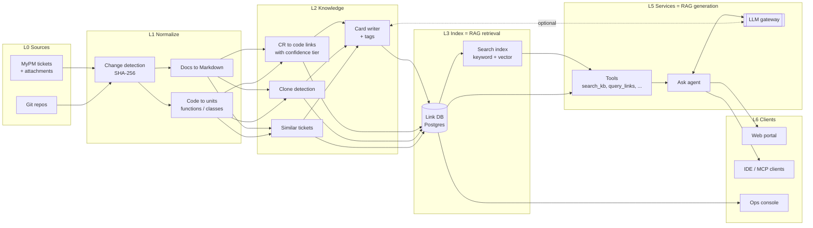
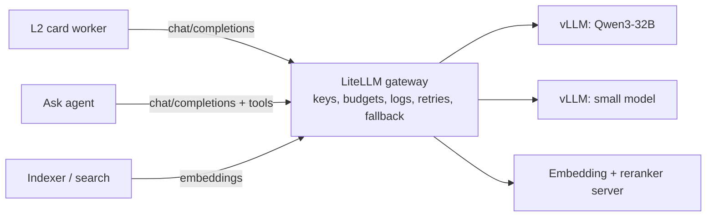
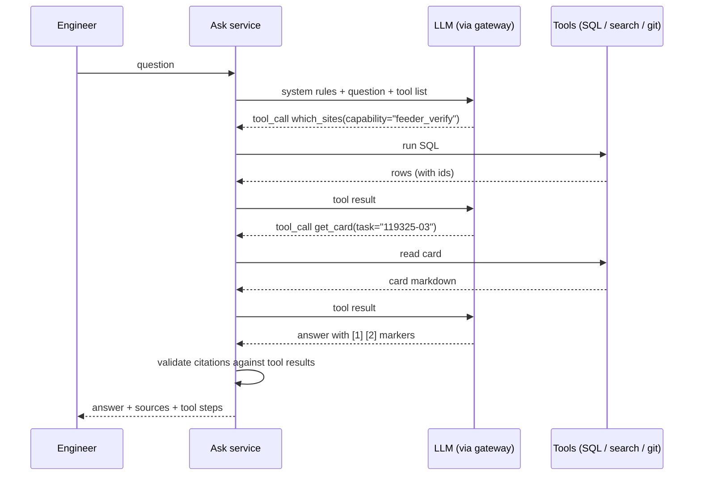
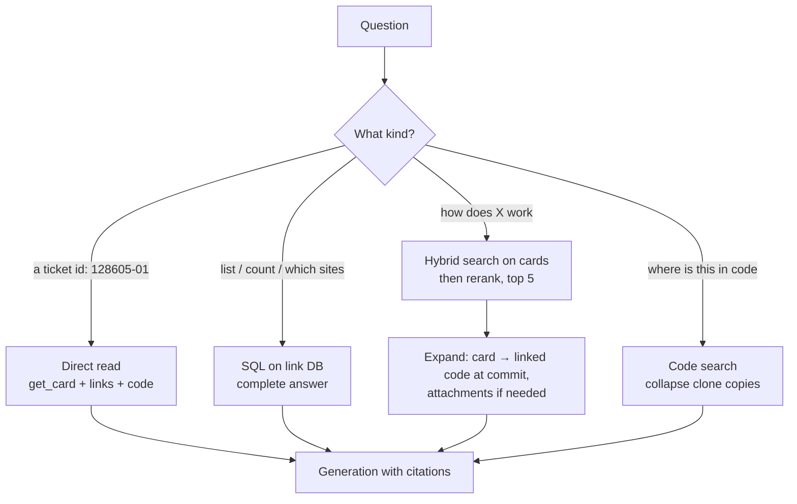
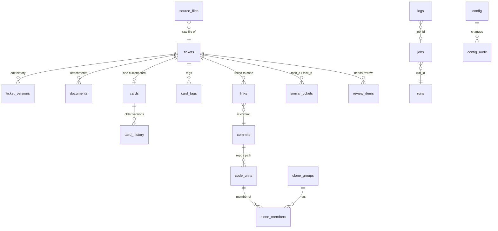
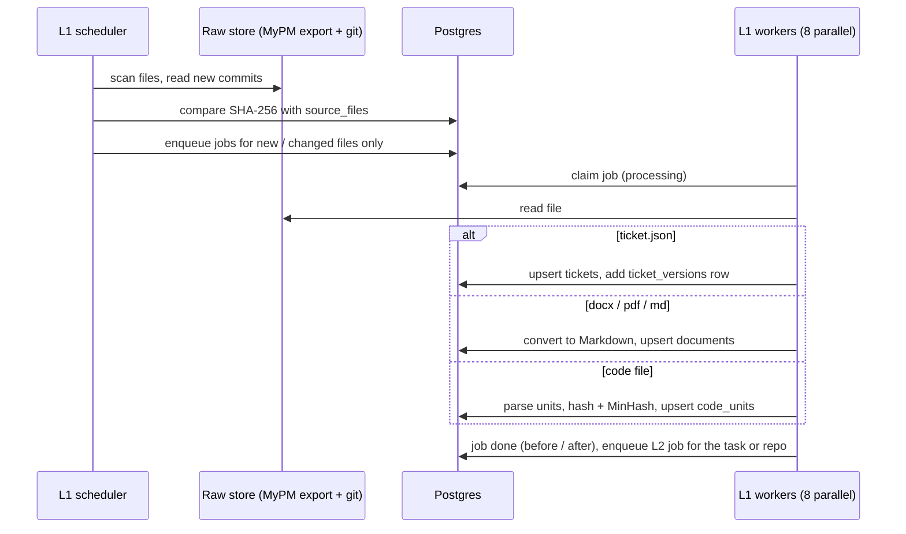
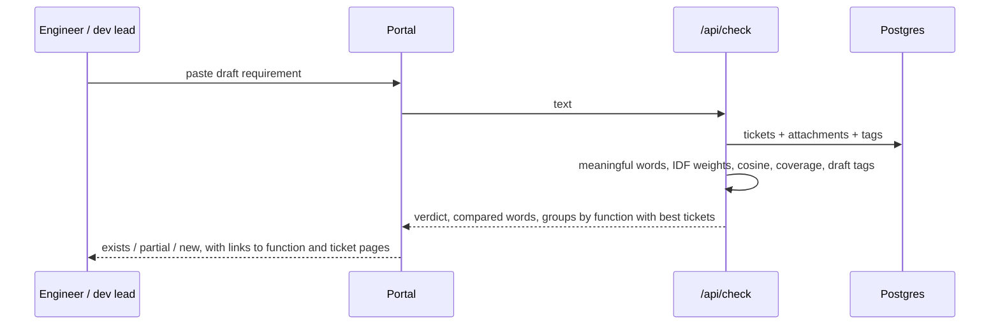
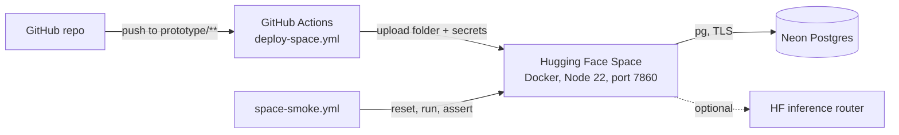

# Shopfloor KB Hub: architecture

This document explains how the KB Hub is built: the components, the technologies, how the models are used, the role of RAG, the database tables and the main flows. It covers two things side by side:

- **Production design**: the proposal for ~20,000 MyPM tickets and all Azure DevOps repos ([docs/project-profile.md](docs/project-profile.md)).
- **Prototype**: what runs today in `prototype/` on a Hugging Face Space with Neon Postgres ([README.md](README.md)).

The prototype keeps the production *shape* (same layers, same tables, same tools, same answer contract) and swaps the heavy parts for small ones, so that each part can be replaced without changing the rest.

## Contents

1. [Big picture](#1-big-picture)
2. [Components and technologies](#2-components-and-technologies)
3. [Models](#3-models)
4. [How the application talks to a model](#4-how-the-application-talks-to-a-model)
5. [Frameworks](#5-frameworks)
6. [RAG in this project](#6-rag-in-this-project)
7. [Function tags](#7-function-tags)
8. [Check before you build](#8-check-before-you-build)
9. [Data model](#9-data-model)
10. [Solution design: main flows](#10-solution-design-main-flows)
11. [Jobs, scheduling and change detection](#11-jobs-scheduling-and-change-detection)
12. [Deployment](#12-deployment)
13. [Security](#13-security)
14. [Quality and evaluation](#14-quality-and-evaluation)
15. [Open decisions](#15-open-decisions)

---

## 1. Big picture

The system turns three raw sources (MyPM tickets, their attachments, and source code in git) into **one knowledge card per ticket revision**, plus a **link database** that connects tickets, commits, code and functions. Engineers then search, ask and check against that knowledge.



L4 (knowledge views: ticket, function and site pages) is rendered straight from the database by the portal, so it does not appear as a separate box.

**Design rules that shape everything else**

| Rule | Consequence |
|---|---|
| The link database is the source of truth, not the vector index | List and count questions ("which sites have feeder verification?") are answered with SQL, completely, never from top-k search |
| Every fact carries its source | Cards tag each sentence `[T1]`, `[A1]`, `[C1]`; answers carry numbered citations; inferred links are always labelled |
| Card first, code on demand | Retrieval returns cards (short, curated) before raw attachments or code, which keeps the model's context small |
| Deterministic before generative | Change detection, parsing, linking, clones, tags and list answers are code. The model only writes prose from given facts |
| Portable, self-managed | Open-weight models behind an OpenAI-compatible API; no vendor-managed AI services (requirement N1/N2) |

---

## 2. Components and technologies

### 2.1 Production design

| Layer | Component | Technology | Why |
|---|---|---|---|
| L0 | MyPM export | Existing downloader app (daily) | Already in place |
| L0 | Code mirror | `git clone --mirror` + `git fetch` of all ADO repos; ADO REST API for the repo list | Full history, so code can be read "as it was" at any commit |
| L1 | Document conversion | Docling or MarkItDown; PaddleOCR / Tesseract for scans | Office/PDF to Markdown with headings and tables kept |
| L1 | Code parsing | tree-sitter (C#, JS/TS, Python); ScriptDom or sqlglot for T-SQL | Functions and stored procedures as units with line ranges |
| L1/L2 | Workers | Python workers reading a job queue in Postgres | Simple, restartable, horizontally scalable |
| L2 | Linking | Rules over repo names, commit messages, dates; text similarity as a fallback | Explainable tiers: confirmed / strong / inferred |
| L2 | Clone detection | Normalized AST hash + MinHash/LSH; embedding similarity for modified copies | Finds copied functions across sites |
| L2 | Card writer | LLM through the gateway, versioned template + prompt | One card per ticket revision |
| L3 | Link database | PostgreSQL 16 | Relational truth, SQL for lists/counts, audit |
| L3 | Search index | OpenSearch or Elasticsearch (self-managed), BM25 + dense vectors | Hybrid keyword + semantic search with filters |
| L3 | Code search | Zoekt | Fast exact and regex search over all repos |
| L3 | Embeddings | BGE-M3 served in-house | Multilingual, long input, dense + sparse output |
| L3 | Reranker | bge-reranker-v2-m3 | Better top-10 precision than vectors alone |
| L5 | LLM serving | vLLM on GPU (EC2 now, company servers later) | High throughput, OpenAI-compatible API |
| L5 | LLM gateway | LiteLLM proxy | One endpoint, keys per client, budgets, logging, model switch without code changes |
| L5 | Agent service | Small service with a tool loop (see section 5) | Answers with citations |
| L5 | MCP server | Model Context Protocol over HTTP | Same tools for the IDE and other AI clients |
| L6 | Web portal | React (or the prototype's plain JS) | Search, Ask, Functions, Check, Code to requirement |
| L6 | IDE | Homegrown desktop IDE (Electron or Tauri) using MCP | "Why was this line written?" inside the editor |
| Platform | Containers | Kubernetes (RKE2 or k3s), MinIO for files | Portable from EC2 to company servers |
| Platform | Identity | Company SSO (Entra ID / OIDC) | Per-user access and audit |
| Platform | Observability | Prometheus + Grafana, Loki for logs, LiteLLM spend logs | Cost and quality tracking |

### 2.2 Prototype

| Part | Technology | Notes |
|---|---|---|
| Runtime | Node.js 22 (ES modules), Express 4 | One process: API, both web front ends, three schedulers |
| Database | Neon Postgres (cloud) via `pg`; PGlite (embedded Postgres in WASM) on a laptop | Same SQL in both; schema in `src/schema.sql` |
| Full-text search | Postgres `tsvector` / `ts_rank` | Stands in for OpenSearch BM25 |
| Raw store | Folder `SIM_DIR`: MyPM exports + one git repo with a sub-folder per source repo | Stands in for downloader output + git mirror |
| MyPM simulator | Own code (`src/sim/`), seeded random timeline of 383 events, 100 tickets | Creates CRs, revisions (+1) and edits, with docx/pdf/md attachments |
| Docs to Markdown | `mammoth` (docx), `unpdf` (pdf), `marked` | Stands in for Docling |
| Code parsing | `acorn` (JavaScript AST); an indentation parser for Python | Stands in for tree-sitter |
| Clone detection | Token MinHash (64 hashes, 4-token shingles) + normalized hash | Same idea as production, smaller |
| Similar tickets | TF-IDF cosine | Stands in for embeddings |
| Card writer | Built-in rule writer; optional open-weight model via the Hugging Face router | `llm.provider` = `builtin` or `hf` |
| Ask | Same tool set as production, grounded answer assembled by code; optional model rewrite | Works with no model at all |
| Tags | Keyword rules over a fixed vocabulary (`src/tags.js`) | Production: the card model picks from the same list |
| Hosting | Docker on a Hugging Face Space (port 7860); deploy and smoke test with GitHub Actions | |

---

## 3. Models

### 3.1 Where a model is used and where it is not

| Task | Model? | What does the work |
|---|---|---|
| Change detection, parsing, code units | No | Hashes, parsers |
| CR to code links | No (rules), embeddings help for inferred links | Repo-name and commit-message rules; similarity for fallback |
| Clone detection | No; embeddings for heavily modified copies in production | MinHash / AST hash |
| **Card writing** (Overview, Business logic, Technical logic) | **Yes, LLM** | Prompt with the ticket, attachments and code units, all source-tagged |
| **Tags** | Rules in the prototype; **LLM** picks from the fixed list in production | Validated against the vocabulary |
| Function pages (summary across all tickets of a function) | **Yes, LLM**, expert-reviewed | Summarizes several cards |
| **Search, Check, Similar tickets** | **Embedding model + reranker** in production | Hybrid search; TF-IDF in the prototype |
| **Ask** | **LLM** with tool calling in production | The agent chooses tools and writes the answer; lists come from SQL |
| Lists, counts, "which sites" | No, never | SQL on the link database |

### 3.2 Proposed models (production)

| Role | Model (proposal) | Size / serving | Alternatives |
|---|---|---|---|
| Card writer + Ask agent | Qwen3-32B (Instruct), or a mid-size model of the same class | vLLM, 1 x 80 GB GPU (A100/H100), or 2 x 48 GB (L40S) with tensor parallel; FP8/AWQ quantization lowers this | Llama 3.3 70B (more GPU), Mistral Small 3.x, Gemma 3 27B |
| Small fast model (classification, tags, query rewrite) | Qwen3-8B or similar | Same vLLM cluster, small GPU slice | Use the main model if volume is low |
| Embeddings | BGE-M3 (1024 dims, 8k tokens, dense + sparse) | CPU possible for queries; GPU for the backfill | multilingual-e5-large, gte-multilingual |
| Reranker | bge-reranker-v2-m3 | Same embedding server | Skip in phase 1 if latency matters more |
| OCR (scanned attachments) | PaddleOCR | CPU/GPU workers | Tesseract |

All are open-weight and run in-house, as requirement N2 asks. The prototype default `llm.model` is `Qwen/Qwen3-32B` through the Hugging Face router, so the prompts are tested against the intended class of model.

**Rough volumes for sizing.** Backfill: ~20,000 cards x (~6k input + ~600 output tokens) is about 130M input tokens. A single 80 GB GPU with vLLM batching handles this in roughly one to three days. The exact number has to be measured on 200 to 500 real tickets first (open decision in section 15). Daily load after the backfill is small: a few hundred changed tickets.

---

## 4. How the application talks to a model

### 4.1 One API shape: OpenAI-compatible chat completions

Every model call, in the prototype and in production, is a plain HTTPS `POST /v1/chat/completions`. Only the base URL and the key change:

| Where | Base URL | Key |
|---|---|---|
| Prototype | `https://router.huggingface.co/v1` | `HF_TOKEN` secret |
| Production | `https://llm-gateway.internal/v1` (LiteLLM) | Per-service virtual key issued by LiteLLM |



LiteLLM gives one endpoint for all models, per-client keys and budgets, request logs with token counts, retries, and a fallback model. Switching or upgrading a model is a gateway setting, not a code change.

### 4.2 Card writing: prompt contract

The card writer sends **only the sources for that ticket**, each with a tag, and asks for a fixed format. This is the prototype's prompt (`prototype/src/cards.js`, `llmSections`):

```text
You write knowledge cards for a manufacturing execution system. Use ONLY the sources below.
Tag every sentence with its source: [T1] for the ticket, [A1].. for attachments in the order
given, [C1].. for code units in the order given.
Return exactly two sections:
OVERVIEW: 3 sentences on what it does, why it was built, where it runs.
BUSINESS: bullet list of the business rules with limits.

[T1] TICKET 119325-03
...ticket body...

[A1] feeder-spec.docx
...attachment markdown (first 2,500 chars)...

[C1] AUS-LUMEN-MYPM119325-feeder/src/verify.py verify_feeder
...code at the linked commit (first 800 chars)...
```

The call (prototype):

```js
const res = await fetch("https://router.huggingface.co/v1/chat/completions", {
  method: "POST",
  headers: { Authorization: `Bearer ${process.env.HF_TOKEN}`, "Content-Type": "application/json" },
  body: JSON.stringify({ model: cfg("llm.model"), messages: [{ role: "user", content: prompt }],
                         max_tokens: 600, temperature: 0.2 }),
});
```

What happens after the call:

1. `<think>…</think>` blocks (reasoning models) are removed.
2. The answer must contain both sections, otherwise the call counts as failed.
3. On any failure the **built-in writer** is used and a warning is logged, so a card is always produced.
4. Model name and token counts are stored on the card (`cards.model`, `tokens_in`, `tokens_out`) for cost tracking.

Technical logic, Variants, History, Gaps and References are always written by code from the link database, so the model cannot invent a commit, a repo or a link.

**Production additions**

| Addition | How |
|---|---|
| Structured output | Ask for JSON (`overview`, `business[]`, `tags[]`) with vLLM guided decoding (`response_format: json_schema`), instead of parsing text |
| Citation check | Every sentence must end with a tag that exists in the prompt (`[T1]`, `[A2]` …). Sentences with unknown or missing tags are dropped or the card is retried |
| Tag check | `tags[]` must be values from the fixed vocabulary; anything else is dropped |
| Template version | `cards.template_version` changes when the prompt changes, so old cards can be regenerated selectively |
| Prompt caching | vLLM prefix caching keeps the fixed instruction part warm across the batch |

### 4.3 Ask: tool calling

In production the Ask agent uses the standard `tools` field of the same API. The model decides which tool to call; the service runs it and sends the result back; the loop ends when the model writes the answer.



Tools (same names in prototype and production):

| Tool | Purpose | Prototype backing | Production backing |
|---|---|---|---|
| `get_index` | Browse by site / customer / function | SQL | Generated index pages |
| `search_kb` | Find cards and documents | Postgres full-text | OpenSearch hybrid + reranker |
| `get_card` | Read one card | `cards` table | Card store |
| `which_sites`, `query_links` | Complete lists, counts, lineage | SQL | SQL |
| `find_similar` | Similar tickets, clone group | `similar_tickets`, `clone_members` | Same + vector neighbours |
| `search_code`, `get_code` | Code search; code at a commit | Postgres full-text; `git show` | Zoekt; git mirror |

**Prototype Ask** runs the same tools, but a small classifier in code (ticket / list / code / explain / entity / tag) picks them, and the answer is assembled from the tool results. With `llm.provider = hf` the grounded answer is then rewritten by the model under the rule "use only these facts, keep every [n] marker". If the model fails, the grounded answer is returned. The portal shows every tool step, so an engineer can see where each fact came from.

### 4.4 Guardrails common to all model calls

- Sources only: prompts state "use ONLY the sources below", and the tools return ids that can be cited.
- Low temperature (0.2) for factual writing.
- Every answer is checked: citations must point to sources that were actually retrieved.
- Inferred links are marked INFERRED in cards and answers, and go to the review queue.
- Each call is logged with model, tokens and duration (`logs`, gateway logs).
- No customer data leaves the company network in production: models run in-house.

---

## 5. Frameworks

### 5.1 Prototype: no LLM framework

The prototype calls the model with `fetch` and implements retrieval, tools and citations in about 500 lines of plain JavaScript (`src/portal.js`, `src/cards.js`). This was deliberate:

- The logic that matters (tiers, list answers from SQL, citations, card-first) is domain logic that no framework provides.
- Every step is visible in the portal's "how this answer was built" panel.
- No dependency to upgrade, and nothing that hides prompts.

Libraries used: Express (HTTP), `pg` / PGlite (database), `mammoth`, `unpdf`, `marked` (documents), `acorn` (JS parsing), `docx`, `pdfkit`, `jszip` (simulator attachments and ticket package download).

### 5.2 Production: thin by choice

| Need | Recommendation | Optional framework |
|---|---|---|
| Model access | OpenAI-compatible client (`openai` Python SDK) pointed at LiteLLM | — |
| Structured output | Pydantic models + JSON schema (vLLM guided decoding) | Instructor |
| Agent loop | Own loop of about 100 lines around `tools` (as in 4.3) | LangGraph if multi-step plans grow; LlamaIndex for ingestion helpers |
| Tool exposure to IDE / other AI clients | Official MCP Python SDK | — |
| Workers | Python, job queue in Postgres (`SELECT … FOR UPDATE SKIP LOCKED`) | Celery or Temporal if the pipeline grows |
| Search client | `opensearch-py` | — |
| Evaluation | Own scripts over a golden question set | Ragas, promptfoo |

The recommendation is to stay thin. The hard parts here are linking, list completeness and citations, and those stay in our own code whichever framework is chosen. A framework can be added later behind the same tool interface without changing the database or the clients.

---

## 6. RAG in this project

RAG (retrieval-augmented generation) means the model answers from documents retrieved for the question, not from memory. Here **L3 is the retrieval half** and **L5 is the generation half**. The project differs from a plain "chunk everything, embed, top-k" setup in four ways.

### 6.1 What is indexed

| Source | Unit (chunk) | Role | Prototype | Production |
|---|---|---|---|---|
| Knowledge cards | Whole card (prototype); section (production) | **Primary**: searched first | `cards.search` tsvector | BM25 + BGE-M3 vector per section |
| Tags | Per card | Filter and boost | `card_tags` | Keyword field in the index |
| Attachments (Markdown) | Whole document; heading/slide in production | Detail the card left out | `documents.search` | BM25 + vector per heading |
| Code | Function / class / procedure | Exact technical lookup | `code_units.search` | Zoekt + vector per unit |
| Link database | Rows | Lists, counts, lineage | Postgres | Postgres |

Every chunk carries the card's front-matter (task, CR, site, customer, region, function, state, tags, link confidence), which is used for filters ("only BKK") and for citations.

### 6.2 Four kinds of retrieval



1. **Direct read** for ticket ids. No search needed.
2. **SQL** for lists and counts. Top-k search can never guarantee "all sites", so these questions never go to the vector index. This is the main reason the link database exists.
3. **Hybrid search** (production: BM25 + vectors, fused with reciprocal rank fusion, then the reranker) for explanation questions, **card first**: cards are short and already summarize ticket + attachments + code, so five cards fit in a small context. Linked code is read at the linked commit only when the question needs it.
4. **Code search** for code questions, with copies collapsed to one hit per clone group, so twelve identical copies do not fill the context.

### 6.3 Generation

The retrieved items are numbered and passed to the model with the rule to answer only from them and keep the markers. The service then checks that every `[n]` exists, and returns the answer with its source list and the tool steps.

### 6.4 Prototype vs production retrieval

| Step | Prototype | Production |
|---|---|---|
| Keyword | Postgres `to_tsquery` with OR terms, ranked by number of matched words; at least half of the meaningful words must match | OpenSearch BM25 |
| Semantic | TF-IDF cosine (similar tickets, Check) | BGE-M3 dense + sparse vectors |
| Rerank | Word-coverage score | bge-reranker-v2-m3 |
| Filters | SQL `WHERE site/customer/region` | Index filters on front-matter fields |
| Generation | Assembled by code, optional model rewrite | Agent with tool calling |

Adding vectors to the prototype is possible without a new service: `pgvector` on Neon plus a small embedding model. That is offered as a next step, not needed for the demo.

---

## 7. Function tags

Tags group tickets by **what the function does** across sites and customers, for example *Traceability*, *Labeling*, *Packing & shipping*. They are a second axis next to the function (capability) itself: one function can carry several tags, and one tag spans many functions.

| Aspect | Design |
|---|---|
| Vocabulary | Fixed list of 15 tags (`prototype/src/tags.js`). A fixed list keeps search and filters stable; it is changed by an admin, not by the model |
| When | Assigned by L2 every time a card is written; stored in `card_tags` and written into the card front-matter (`tags: [...]`) |
| How (prototype) | Keyword rules on the ticket, attachments and title, after removing boilerplate (line names, spec template sentences). A tag needs two different keywords, or one keyword that is also in the title. Matched words are kept as `evidence` |
| How (production) | The card model returns `tags[]` chosen from the same list (JSON schema enum); `source = 'llm'` |
| Expert control | Experts add or remove tags (`source = 'expert'`); regeneration never overwrites expert tags |
| Function level | A function shows a tag when at least a third of its cards carry it (and at least two cards once it has three or more), so one passing mention does not tag a whole function |
| Used by | Search text (tags are added to the card's search vector), the Functions page (tag chips, text filter, site filter), Ask ("which functions are about traceability?" answers from `card_tags`), Check before you build (shared tags add to the score and are shown) |

---

## 8. Check before you build

Goal: before a new CR is approved, show whether the same function already exists somewhere, so it can be reused instead of rebuilt.

**Prototype scoring** (`POST /api/check`):

1. Take the meaningful words of the draft (filler words such as "please", "would", "like", "site" are removed).
2. For each existing ticket (body + attachments + title) compute:
   - `cosine`: TF-IDF similarity between the draft and the ticket;
   - `coverage`: the share of draft words found in the ticket, **weighted by IDF**, so rare words such as *feeder* or *stencil* count more than common ones such as *operator*. Words the knowledge base has never seen still count against the match;
   - `tags`: tags the draft would get (same rules as cards) that the ticket also has.
3. `score = min(1, 0.35 x cosine + 0.65 x coverage + min(0.1, 0.05 x shared tags))`.
4. Group by function, keep the best ticket per function.
5. Verdict: **exists** if the best score is at least 0.45, **partial** if at least 0.25, otherwise **new**. A draft with fewer than two meaningful words is never called "exists".

The result page shows the verdict, the words it compared on (unknown words struck through), the tags, and the matching tickets with their sites, state and link confidence.

**Production**: the same steps with BGE-M3 vectors instead of TF-IDF, the reranker scoring draft vs. card, and a short model-written explanation of what is the same and what differs, citing the matched cards.

---

## 9. Data model

All tables are in `prototype/src/schema.sql`; production uses the same model in PostgreSQL, with large text (Markdown, card bodies) optionally moved to MinIO and referenced by path.

### 9.1 Entity relationships



### 9.2 Tables

**Knowledge (L1 normalized)**

| Table | Key | Main columns | Purpose |
|---|---|---|---|
| `tickets` | `task` (e.g. `121648-02`) | `cr`, `rev`, `title`, `project`, `site`, `customer`, `region`, `state`, `priority`, `owner`, `created`, `required`, `last_edit`, `edit_no`, `capability`, `body_md`, `sha256`, `search` | One row per ticket revision (latest edit) |
| `ticket_versions` | `task, edit_no` | `snapshot` jsonb | Every edit seen, for history and "what changed" |
| `documents` | `id`; unique `task, file_name` | `format` (md/docx/pdf), `sha256`, `markdown`, `chars`, `search` | Attachments converted to Markdown |
| `commits` | `sha` | `repo`, `message`, `author`, `committed_at`, `files[]` | Git history used for linking |
| `code_units` | `id`; unique `repo, path, name` | `kind`, `lang`, `start_line`, `end_line`, `commit_sha`, `norm_hash`, `minhash int[]`, `doc`, `body`, `search` | Functions and classes |

**Knowledge (L2/L3 derived)**

| Table | Key | Main columns | Purpose |
|---|---|---|---|
| `links` | `id`; unique `task, repo, commit_sha, tier` | `tier` (confirmed/strong/inferred), `evidence`, `score`, `source` (auto/expert), `status` (active/rejected) | Ticket to code, with the reason |
| `clone_groups` | `id` | `origin_unit`, `label` | One group per original function |
| `clone_members` | `group_id, unit_id` | `role` (origin/exact/variant), `similarity` | Copies of a function across repos |
| `similar_tickets` | `task_a, task_b` | `score` | Similar requirements (both directions stored) |
| `cards` | `task` | `version`, `template_version`, `card_md`, `overview`, `link_confidence`, `status`, `model`, `tokens_in`, `tokens_out`, `generated_at`, `search` | Current knowledge card |
| `card_history` | `task, version` | `card_md`, `model`, `generated_at` | Every earlier card version |
| `card_tags` | `task, tag` | `source` (rule/llm/expert), `evidence` | Function tags; index on `tag` |
| `review_items` | `id`; unique `kind, ref` | `kind` (inferred_link/clone/duplicate/unlinked/feedback), `title`, `detail` jsonb, `status`, `decided_by` | Expert review queue and user feedback |

**Operations**

| Table | Purpose |
|---|---|
| `source_files` | Registry of every raw file seen: path, kind, SHA-256, size, first seen, last change (change detection) |
| `jobs` | Work queue: stage (L1/L2), kind, ref, status (pending/processing/done/failed), before/after snapshot, error, attempts |
| `runs` | One row per scheduler run: picked, done, failed |
| `logs` | Structured log with stage, run, job, task and jsonb data |
| `config`, `config_audit` | Settings and who changed them |
| `sim_state` | Prototype only: simulator seed, cursor, simulated clock |

### 9.3 Production additions

| Addition | Why |
|---|---|
| `functions` table (key, title, description, owner, status) | Functions become managed entities with an owner, instead of a code constant |
| `tags` table (tag, description, keywords, active) | Vocabulary managed by admins |
| `card_sections` (task, section, text, embedding vector) or the OpenSearch index | Section-level retrieval |
| `users`, `feedback`, `answer_log` | Per-user access, feedback analytics, evaluation data |
| Partitioning `logs` by month | Volume |

---

## 10. Solution design: main flows

### 10.1 Ingestion (L0 → L1)



### 10.2 Knowledge (L2): links, clones, similar, card

```mermaid
sequenceDiagram
  participant W as L2 worker
  participant DB as Postgres
  participant G as git
  participant L as LLM (optional)
  W->>DB: repo job: new commits
  W->>W: link commit to CR: repo name MYPM<cr> → confirmed; "CR 123456-02" in message → strong
  W->>DB: links; unlinked or inferred → review_items
  W->>DB: clone detection (MinHash ≥ 0.75, origin is the older unit)
  W->>DB: card job for each affected task
  W->>DB: similar tickets (TF-IDF ≥ 0.3), duplicate flag ≥ 0.45
  W->>G: git show <linked commit>:<path> (code as it was)
  W->>L: optional: write Overview + Business logic from tagged sources
  W->>W: Technical logic, Variants, History, Gaps, References from DB
  W->>W: tags = tagText(ticket + attachments, title)
  W->>DB: cards (+ card_history), card_tags, search vector
```

**Link tiers**

| Tier | Evidence | Shown as |
|---|---|---|
| confirmed | Repo named after the CR, and revision from commit message or date | Fact |
| strong | CR id in the commit message, or approved by an expert | Fact |
| inferred | Code is a clone of code linked elsewhere, or text similarity + customer hint | "INFERRED", sent to review |
| unlinked | Nothing found | Gap on the card, sent to review |

### 10.3 Ask

See the sequence in section 4.3. Prototype order of checks: ticket id (read that ticket) → a site, customer or region with no other topic (list everything there) → tag question (functions with that tag) → search for the function, then a complete list from SQL for list questions, code for code questions, or an explanation from the best cards. Each step is recorded and shown.

### 10.4 Check before you build



### 10.5 Feedback and review

Engineers mark answers and cards as helpful, wrong link or outdated (`POST /api/feedback`). Anything other than "helpful" becomes a `review_items` row. Experts approve or reject inferred links in the ops console; an approved link becomes `strong` with `source = 'expert'`, and the card is regenerated.

---

## 11. Jobs, scheduling and change detection

| Scheduler | Default interval | Batch | Does |
|---|---|---|---|
| SIM (prototype only) | 4 s | 2 events | Plays the MyPM timeline: new CRs, revisions, edits, commits |
| L1 | 3 s | 12 jobs | Scan, detect changes, normalize |
| L2 | 4 s | 10 jobs | Links, clones, similar, cards |

- **Idempotent**: every write is an upsert keyed on natural ids; re-running a job gives the same result.
- **Only changes**: SHA-256 per file and "new commits only" keep daily work proportional to what changed.
- **Parallel**: card jobs run 8 at a time; repo jobs run one at a time so links and clones are consistent.
- **Observable**: each job keeps `before` / `after`, errors and attempts; the ops console shows pending, processing, done and failed.
- **Repeatable demo**: reset truncates all knowledge tables and replays the seeded timeline; the same seed gives the same commits and the same cards.

Production keeps the same queue tables, with workers claiming jobs using `FOR UPDATE SKIP LOCKED`, and runs L0 once a day after the MyPM download.

---

## 12. Deployment

### 12.1 Prototype



Secrets live only in GitHub Actions secrets and Space secrets: `DATABASE_URL`, `HF_TOKEN`, optional `ADMIN_PASSWORD`.

### 12.2 Production

| Item | Plan |
|---|---|
| Cluster | Kubernetes (RKE2 or k3s) on EC2 now, company servers later |
| GPU | 1 to 2 GPU nodes for vLLM; embeddings on a smaller GPU or CPU |
| Stateful | PostgreSQL (managed by us, with backups), OpenSearch (3 nodes), MinIO, git mirror volume |
| Services | L1/L2 workers, agent/API service, MCP server, portal, LiteLLM, vLLM, embedding server, Zoekt |
| Network | Internal only; portal behind SSO; no outbound calls to model vendors |

---

## 13. Security

| Topic | Prototype | Production |
|---|---|---|
| Identity | None for the portal; optional `ADMIN_PASSWORD` for ops actions (`x-admin-key` header) | SSO (OIDC) for all users; roles: engineer, expert, admin |
| Secrets | GitHub and Space secrets, never in the repo | Kubernetes secrets / vault; LiteLLM virtual keys per service |
| Data | Simulated data only | Stays in company network; models run in-house |
| Code access | Read-only from the raw store; path traversal checks on `/api/source` | Read-only git mirror; repo-level permissions respected in search |
| Prompt injection | Sources are quoted as data; model output never runs tools by itself in the prototype | Tool calls validated and parameterized; SQL tools are fixed queries; answers checked for citations |
| Audit | `config_audit`, `logs`, `review_items.decided_by` | Same, plus gateway logs per user |

---

## 14. Quality and evaluation

| What | How |
|---|---|
| Link accuracy | Sample of links checked by experts per tier; target: confirmed/strong above 95% precision |
| Card faithfulness | Every sentence has a valid source tag; sample review by experts; regenerate on template change |
| Retrieval | Golden set of 100+ real engineer questions with expected tickets; measure recall@5 and MRR for each change to search |
| List answers | Compared with SQL ground truth: must be complete |
| Ask answers | Citation validity (automatic), helpfulness from feedback buttons |
| Check before you build | Historic CRs replayed as "drafts": did the check find the earlier function? |
| Cost | Tokens per card and per answer from `cards.tokens_*` and gateway logs |

The prototype's smoke test (`.github/workflows/space-smoke.yml`) runs the pipeline in the cloud and asserts cards, links, Ask, the portal and the ops console on each deploy.

---

## 15. Open decisions

| Decision | Options | Needed for |
|---|---|---|
| Main LLM and GPU type | Qwen3-32B on 1 x 80 GB vs. a 70B model on 2 GPUs | Budget and backfill time |
| Search engine | OpenSearch vs. Elasticsearch (licence) | L3 |
| Tag vocabulary | Who owns it; how many tags | Functions page, Check |
| Function list | Generated from clusters vs. curated by experts | Function pages |
| Agent framework | Own loop (recommended) vs. LangGraph | L5 |
| IDE scope | Full homegrown IDE vs. plugin for an existing IDE using MCP | L6 |
